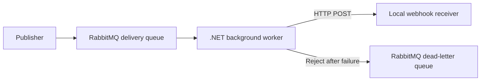

# Webhook Delivery Worker

A .NET 10 background service that consumes RabbitMQ messages and delivers their JSON payloads to an HTTP endpoint. The demo uses a simulated payment event and a local receiver.



## Run the demo

Start RabbitMQ with Docker. The two ports are bound to localhost for development.

```sh
docker run --rm -d --name webhook-rabbitmq \
  -p 127.0.0.1:5672:5672 -p 127.0.0.1:15672:15672 rabbitmq:4-management
docker exec webhook-rabbitmq rabbitmq-diagnostics -q ping
```

In one terminal from the repository root, start the mock receiver. Use `FAIL_FIRST=2` to demonstrate retries, or omit it for immediate success.

```sh
FAIL_FIRST=2 python3 demo/receiver.py
```

In a second terminal, start the worker. Wait for `Waiting for messages on webhook.delivery`.

```sh
dotnet run
```

In a third terminal, publish to the queue using RabbitMQ's local management API.

```sh
curl --fail-with-body -u guest:guest \
  -H 'Content-Type: application/json' \
  -d '{"properties":{"delivery_mode":2},"routing_key":"webhook.delivery","payload":"{\"eventId\":\"demo-001\",\"type\":\"payment.succeeded\"}","payload_encoding":"string"}' \
  http://localhost:15672/api/exchanges/%2F/amq.default/publish
```

The broker responds with `{"routed":true}`. The receiver should log two HTTP 503 responses followed by HTTP 204. Restart the receiver with `FAIL_FIRST=3` and publish with a fresh event ID to exercise dead-lettering. Check the `webhook.delivery.dead` queue in the [RabbitMQ management UI](http://localhost:15672), using `guest` for both username and password.

The worker acknowledges messages after HTTP success. Network failures, timeouts, HTTP 408, 429 and 5xx are retried after one and two seconds. Other HTTP failures and malformed events go straight to the dead-letter queue. An unacknowledged delivery can be redelivered after a worker disconnects, so a real receiver should deduplicate using the event ID. Retry attempts run in memory and start over after a restart.

Override the defaults with `RabbitMq__Uri` or `Webhook__Url`. Stop the demo with Ctrl+C in the worker and receiver terminals, then run `docker stop webhook-rabbitmq`.
